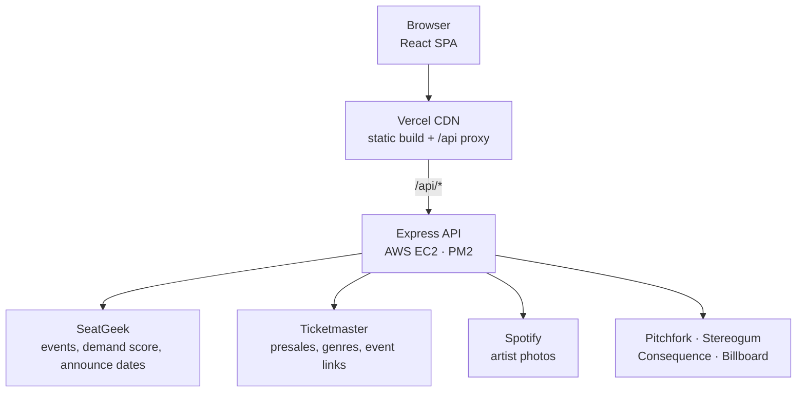

# Front Row

A concert discovery site that ranks every upcoming tour in America by how
hyped it is, tells you when the presale opens, and keeps up with what the music
press is covering.

**Live:** https://frontrow-tickets.vercel.app

Concerts only — no sports, no theater.

---

## The problem, and how the project ended up here

Front Row started as a **ticket price predictor**: track resale prices nightly,
run a Monte Carlo simulation over the history, and tell you whether to buy now
or wait.

That ran into a wall, in two stages.

**SeatGeek and Ticketmaster both gate resale pricing behind partner-level API
access.** Event search works fine; `stats.lowest_price` comes back empty and
`priceRanges` is usually absent. You can learn that Zach Bryan plays Denver in
August. You cannot learn what a ticket costs today.

So the obvious answer was to collect the data instead — a nightly Puppeteer bot
reading get-in prices off marketplace pages. **That hit DataDome**, commercial
bot detection, which served a 1.6 KB captcha challenge instead of the event
page. Two signals were working against it: headless browser fingerprinting, and
the fact that requests came from an AWS datacenter IP that no real ticket buyer
browses from.

The options were residential proxies (~$50/month to keep losing an arms race),
stealth plugins (unreliable against DataDome specifically), or accepting that
the site was saying no.

**So the product changed to match the data that was actually available.** Prices
are gated. *Popularity is not* — SeatGeek returns a demand score, an
announcement date and venue capacity on every event, free. Ticketmaster returns
every presale window. Publishers hand out RSS on purpose.

Front Row now answers **"what is worth going to, and when can I get tickets"**
instead of **"will this get cheaper"**. Same infrastructure, same APIs, a
question the data can actually answer.

---

## What it does

**Hype ranking.** Every upcoming tour in the US, scored and ordered.

**Tour grouping.** Olivia Rodrigo playing 30 arenas is one panel saying "30
dates", not 30 near-identical rows.

**Venue size tiers.** Arenas, theatres and clubs are browsed separately, so a
club tour competes with other club tours rather than with Beyoncé.

**Presale alerts.** Windows open now or opening within two weeks, ranked.

**A feed.** Just-announced tours, presales, and music headlines from Pitchfork,
Stereogum, Consequence and Billboard.

**Location filtering.** Everything scopes to a city from the header.

---

## The hype score

Four weighted signals, blended into 0–100:

| Signal | Weight | Source |
| --- | --- | --- |
| Demand | 45% | SeatGeek's own event score |
| Venue size | 25% | Capacity, falling back to venue-name patterns |
| Freshness | 15% | `announce_date`, decaying linearly over 45 days |
| Tour length | 15% | Date count, logarithmic |

Demand carries the most because it is the only component derived from real
behaviour rather than inference. The rest is context that stops a single number
from being the whole story.

**Every component is returned to the client** and rendered as four bars on the
tour page. That is deliberate: a ranking nobody can explain is a ranking nobody
trusts, and being able to say *why* something is third is worth more than a
slightly better score nobody can interrogate.

Logarithmic tour length because the difference between 1 and 10 dates matters
far more than between 30 and 40. Linear freshness decay rather than a cliff, so
an item slides down the feed instead of vanishing overnight.

---

## Architecture



The frontend never calls the API host directly. Vercel rewrites `/api/*`
server-side to EC2, which sidesteps the mixed-content block on an HTTPS page
calling a plain HTTP origin and means there is no CORS configuration to keep in
sync. The browser only ever sees one origin.

There is no database. Every feed is derived from live APIs and cached in
memory — rankings for 15 minutes, artist photos for 24 hours, headlines for 30.
A database returns when accounts and favourites do.

---

## Engineering decisions worth explaining

**Cross-provider entity resolution.** The same concert exists on SeatGeek as
`17871645` and on Ticketmaster as `G5dFZ975dZstp`, with no shared key. They are
matched on **date + normalised venue city** — the only attributes both report
identically. IDs are unrelated; titles are formatted differently ("Zach Bryan-
With Heaven On Tour" vs "Zach Bryan"). Where several candidates share a key, a
title-token overlap breaks the tie. That same matcher is reused three times: to
attach on-sale dates, to pull genres, and to link each tour date to its
Ticketmaster page.

**Grouping by headliner, not title.** Titles vary per tour stop, so grouping on
them would split one tour into several. The first performer is the headliner on
every SeatGeek concert response, which makes it the only stable grouping key.

**A tour's size is its biggest room, not its average.** A stadium run with two
club warm-ups is still a stadium run.

**Genre comes from Ticketmaster because SeatGeek has none.** Dumping SeatGeek's
`/taxonomies` endpoint proved it: the entire Concerts branch is two nodes,
"Concert" and "Music Festivals". Not a wrong parameter — the data does not
exist. Ticketmaster classifies music as Segment > Genre > Sub-Genre, filtered by
exact `genreId` rather than by name, since name matching also pulls in
sub-genres.

**RSS, not scraping, for headlines.** Publishers hand out a machine-readable
feed deliberately. Nothing to defeat, nothing to break when a layout changes.
After DataDome, that distinction is the whole point.

**Caching is layered by how fast each thing changes.** Rankings 15 minutes,
artist photos 24 hours, headlines 30 minutes. Cache misses are cached too — an
artist Spotify cannot find will not become findable on the next request.

---

## Stack

| Layer | Choice |
| --- | --- |
| Frontend | React 19, Vite, TypeScript, Tailwind v4, React Router 7 |
| Backend | Node, Express, TypeScript |
| Hosting | Vercel (static CDN) + AWS EC2 under PM2 |
| Data | SeatGeek, Ticketmaster, Spotify, publisher RSS |

The backend has exactly two runtime dependencies: `express` and `dotenv`.

---

## Local setup

Two separate npm projects; there is no root `package.json`.

```bash
git clone https://github.com/danielj2290/FrontRow.git
cd FrontRow
cp .env.example .env     # add your own API keys
```

`.env` lives at the **repo root**, not in `/backend` — one file shared by
everything, one place to rotate keys.

```bash
cd backend && npm ci && npm run dev      # API on :3000
cd frontend && npm ci && npm run dev     # Vite on :5173, proxies /api
```

```bash
npm run test:apis    # verify all three API integrations
```

---

## API

| Endpoint | Description |
| --- | --- |
| `GET /api/news?city=` | The feed: announcements, presales, headlines |
| `GET /api/tours/hyped?limit=&city=` | Top-ranked tours |
| `GET /api/tours?size=large\|medium\|small&city=` | Browse by venue size |
| `GET /api/tours/:id` | One tour, all dates, hype breakdown |
| `GET /api/tours/presales?city=` | Presale windows |
| `GET /api/events?artist=&city=&genre=` | Event search |
| `GET /api/events/:id` | One event — accepts `sg-` or `tm-` ids |
| `GET /api/artists/:name` | Artist profile and upcoming shows |

---

## Roadmap

- [x] Hype ranking, tour grouping, venue size tiers
- [x] Presale tracking
- [x] Feed with announcements and music headlines
- [ ] Accounts and favourite artists
- [ ] Email alerts when a followed artist announces a tour or opens a presale
- [ ] Personalised ranking based on what you follow
- [ ] Price history, if a legitimate data source becomes available

---

## License

MIT
